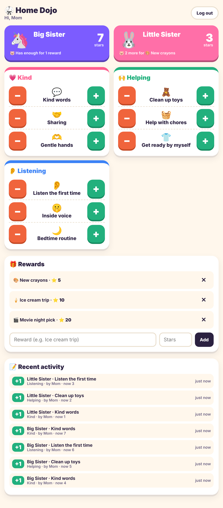
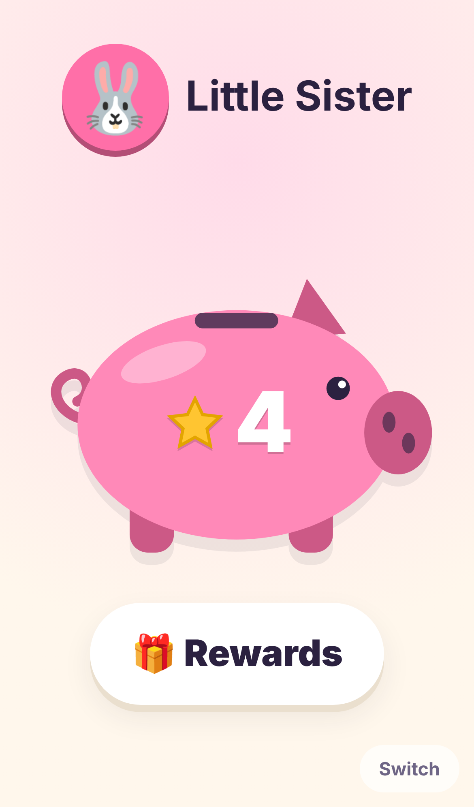
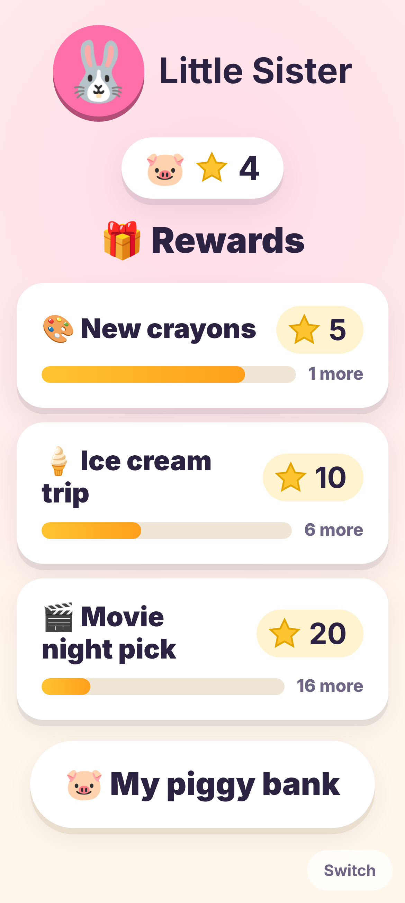

# Home Dojo

A family points app for two daughters. It installs to the home screen on iPads and phones, and every device reads the same scores from one shared database.

- **Stack:** plain Node.js (22.13 or newer) with no npm dependencies, plus one SQLite file through the built-in `node:sqlite`. The front end is a static installable web app (PWA) served by the same process.
- **Parents:** two PINs (mom and dad), set as environment variables. Every change is logged with the parent's name.
- **Kids:** each daughter has her own login (tap her picture, or a PIN if you set one). She sees only her own piggy bank, in her color, with her star count on its side. When a parent gives her a star, stars drop into the slot and the pig wiggles. Kids get no edit controls, and the server rejects edits from a kid login.
- **Scoring:** behaviors are grouped as Kind, Helping and Listening, and each one has a + and a − button. Scores never go below 0. Every tap is logged with the time, behavior, daughter and parent, including a minus at 0 (logged as "already at 0").
- **Rewards:** the list starts empty. Parents add rewards with a star price on the dashboard. Each girl has a Rewards page listing every reward with its star price, which ones she already has enough for, and how many more she needs for the rest. Cashing stars in isn't built yet: a girl's stars only go down when a parent taps a −.

<p>
  
  
  
</p>

More screenshots are in [`docs/screenshots/`](docs/screenshots/).

> This folder sits inside a GitHub Pages repo, but GitHub Pages can only serve static files. The app needs a host that runs Node and has a persistent disk (see Deploy below).

## Run locally

```bash
cp .env.example .env    # then fill in MOM_PIN, DAD_PIN, names, SESSION_SECRET
npm run dev             # http://localhost:3000
npm test
```

## Environment variables

| Variable | Required | Notes |
|---|---|---|
| `MOM_PIN`, `DAD_PIN` | yes | 4 to 8 digits, and they must be different |
| `MOM_NAME`, `DAD_NAME` | no | The name written in the log (defaults: Mom, Dad) |
| `KID1_NAME`, `KID2_NAME` | no | Daughters' names |
| `KID1_EMOJI`, `KID1_COLOR` (same for 2) | no | The picture and color on her card, e.g. `🦄` and `#7c5cff` |
| `KID1_YOUNG`, `KID2_YOUNG` | no | `true` gives the picture-first view with bigger stars (on for kid 2 by default) |
| `KID1_PIN`, `KID2_PIN` | no | Leave empty for tap-your-picture login |
| `SESSION_SECRET` | strongly recommended | A long random string. If you leave it unset, everyone is logged out on every restart |
| `DB_PATH` | no | Location of the SQLite file. Point it at a persistent volume |
| `SECURE_COOKIES` | no | Defaults to true when `NODE_ENV=production`. Needs HTTPS |

Changing a PIN takes effect on the next restart. Changing `SESSION_SECRET` logs every device out.

## Deploy

Any host that runs a Docker container with a persistent volume works, such as Fly.io, Railway or Render (with a paid disk), or a home server or NAS.

```bash
docker build -t home-dojo .
docker run -d -p 3000:3000 -v home-dojo-data:/data --env-file .env -e NODE_ENV=production home-dojo
```

Put it behind HTTPS. Installing to the home screen and secure cookies both need HTTPS. Health check: `GET /healthz`.

## Install on iPad or iPhone

Open the site in Safari, tap **Share**, then **Add to Home Screen**. Log in once as the daughter who uses that device. Kid logins last a year, and parent logins last 90 days.

## Customizing behaviors

The default behaviors (three per group, 1 point each) are created in the `behaviors` table on first run. To change them, edit that table, or edit `DEFAULT_BEHAVIORS` in `src/db.js` before the first run. Each row has a `grp` (kind, helping or listening), a `label`, an `emoji` and a `points` value.

## API (all JSON)

`GET /api/me` · `GET /api/login-options` · `POST /api/login/parent {pin}` · `POST /api/login/kid {kidId, pin?}` · `POST /api/logout` · `GET /api/kid` · parent only: `GET /api/dashboard`, `GET /api/log?limit=`, `POST /api/points {kidId, behaviorId, direction: 1|-1}`, `POST /api/rewards {name, threshold}`, `DELETE /api/rewards/:id`.

Requests that change data must send the header `X-Requested-With: home-dojo`. After 5 wrong PINs, that device is locked out for 1 minute.
